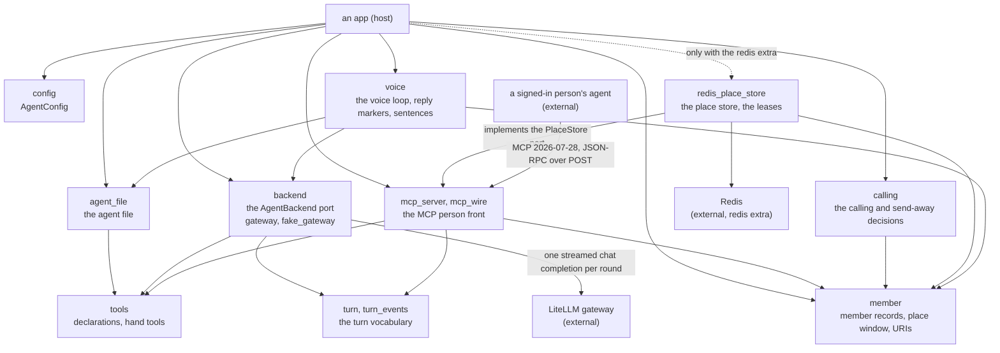

# Architecture

The mental model of this repository, for an engineer who changes the client or decides how an
app builds on it. The code and its docstrings own behaviour, `docs/connector.md` is the
reference for apps and `AGENTS.md` owns the checks and the release rules.

## Context

One library, `agents`, for apps that run agent turns, serve their tools to a signed-in person's
agent and let agents act as members of a place. An app ships its agents as files and declares its
tools in code. The client sends each turn to the app's LiteLLM gateway with the app's own key, runs
the tool calls in the app's process and streams the turn back as typed events; model providers are
reached only through the gateway.

*Which module an app reaches and what each reaches in turn. Source: `src/agents`.*

## Building blocks

- The **base** depends on `pydantic` and `ruamel.yaml` only: `agent_file` (the agent-file reader),
  `front_matter` (the YAML front matter the agent file and a skill share), `skills` (an app's skills
  as SEP-2640 defines them), `tools` (the tool contract and the one owner that turns a record into a
  tool's input schema), `figure_vocabulary` (figure's gestures, framings and moods, generated from
  the pinned figure release, so figure alone decides what an agent can show), `turn` (the turn's
  vocabulary, the size bounds and the failure codes), `turn_events`, `config`, the `backend` port
  and `member` (the records an app and an agent say to each other about a member, the place window
  and the place view) with `member_presentation` (an agent's looks, figure and voices) and
  `member_place` (a place's reference and the URIs of its window and view), and `calling` (the
  decisions of calling and sending away an agent, pure, on facts the app supplies); and
  `member_outcomes`, the failures and codes of a call to an app's member endpoint, pure so that a
  runner's decisions read them without the client.
- The **`backend` extra** adds `httpx2` for `backend.gateway.GatewayBackend`, the port's one
  implementation, and `backend.fake_gateway`, its test transport. `http_client` builds the
  `httpx2` client of the gateway and of the member client: no proxy variable read, no redirect
  followed, no cookie kept.
- The **`mcp-server` extra** adds `anyio` and the official MCP SDK for `agents.mcp_server`, a thin
  ASGI shell before the SDK that serves an app's tools to one signed-in person's agent on MCP
  revision 2026-07-28, with the `MemberResources` port through which a member reads an app's truth
  and `MemberHearing`, the in-memory record of who hears whom ([hearing.md](hearing.md)); the
  `PlaceStore` port has `InMemoryPlaceStore` for a host's tests and `RedisPlaceStore` for pods;
  `mcp_wire` holds what the SDK does not own (the strict JSON reader, the bearer-reflection check).
- The **`mcp-client` extra** adds `anyio`, `httpx2`, logline and the official MCP SDK for
  `agents.mcp_client`, what a runner sends an app's endpoint: `open_member_session`, one SDK
  session on `http_client`'s policy that reads the member's standing, place and view and folds
  what goes wrong into the failures of `member_outcomes`, and the `skills/list` and `skills/get`
  requests. The session writes no log line and decides nothing; the URL, the bearer source and the
  transport come from the host. It and `agents.mcp_server` import each other nowhere.
- The **`redis` extra** adds `overnightworks-tandem`, which brings `redis`, for
  `agents.mcp_server.redis_place_store`, the only module that imports tandem; no agents module
  imports `redis`. The place store is what the pods of one app share, through the `PlaceStore`
  port of `mcp_server.place_store`: `ResourceChanges` publishes an address, never content, on
  tandem's wake channel under `<key_prefix>-agents`, apart from the host's own keys, and the same
  port keeps the listen record, so every pod answers who listens and a pod that dies loses its
  claim after `claim_for`. The `LeaseRecord` port keeps a member's lease on tandem's `Leases`, and beside it the
  member's owner and name for the lease's span, so a lease and its facts survive the pod that
  renewed them; `MemberLeases` (`mcp_server.leases`) supervises the lapse
  service. `agents.mcp_server` does not re-export `RedisPlaceStore`, so an app without
  `ResourceChanges` or `MemberLeases` never loads tandem. `docs/connector.md` owns the contract.
- The **`voice` extra** adds `syntok` and logline's `unit_trace` for `agents.voice`: the voice loop
  (`voice.loop.run_voice_loop`) on the `AgentBackend` port, its ports `VoiceOut` and `WakeRule`,
  the reply markers and sentence release (`voice.reply`), the running conversation
  (`voice.conversation`), the standard wake rule and the echo rule that keeps the agent's own
  voice out of the conversation. The loop also holds its own answer when a person talks over it
  (`voice.talk_over` decides what a talk-over is, from the partial speech the host gives), pauses
  the host's sound through `VoiceOut` and ends the hold with one more decision.

## Runtime

A turn runs inside the app's process. `GatewayBackend.run` admits the person, reads the key
file and streams one chat completion per round: the text reaches the app as the model writes it,
and when a round asks for tools the app's handlers run in order once it is judged whole, before the
next request. A turn names tools it sends deferred and records every tool round whole on
`FinalEvent.tool_rounds`; a host replays them as `Turn.messages`, and one renderer writes a round
the same way for the turn and for the replay, so the next turn's request begins with the last
request of the one before and the provider's cache keeps the prefix. One deadline bounds the
turn. The client holds no state between turns, except the
gateway backend's pooled connections, which the host closes, and the voice loop's conversation,
held in memory while it runs. With the `redis` extra, leases and listen records live in Redis, the
one state outside a process.

The voice loop runs in the host's process too. The host's wake rule decides which heard line
starts a decision. One decision is in flight at a time: one task reads its turn while another
plays its sentences in order through the host's `VoiceOut`, so the turn's deadline bounds the
writing, never the playing, and a third renders the next sentence, never more than one ahead.
The loop holds itself: when a person talks over its answer it pauses the host's sound, waits until
the talk-over has ended and the held turn has been read to its end, and runs one hold decision,
so no two model calls overlap.

The MCP person front is mounted by the host behind the host's own authentication gate. It
resolves the person through a port, answers `tools/list` and `tools/call`, and replays a marked
route as an in-process request into the host's application.

Every answer of the front is buffered, so a bearer reflected into it can be withheld whole. The
one streaming path is `subscriptions/listen`, per verified principal: a change published through
the place store reaches every pod's subscription, which wakes that principal's open streams. A
subscription that fails for good turns the front dead, which answers 503 until the pod restarts,
because a pod that no change reaches would serve stale truth. The shell's writer checks each frame
for the bearer and caps the call, because the SDK's write to a client has no timeout.

## Deployment

Every block runs inside the host app's process: agent files and the key file come from the app's
own disk, and the person front is mounted in the host's ASGI application, the only way the
signed-in person's agent reaches it. The LiteLLM gateway is the one outside service of a turn,
reached over HTTP with the app's key; an app with more than one pod adds Redis for the place store.

## Crosscutting concepts

**Host facts come from the host.** The gateway origin and key file are read from the app's `agent`
section; tools and MCP handlers are ports. Nothing defaults; a malformed value fails loud.

**Trust.**

- *An app holds its own gateway key.* The key has its own budget, sits in a file the configuration
  names, is read per turn and is written to no log record.
- *The app owns its tools and their effects.* A tool's effect class defaults to side-effecting and
  never reaches a model; the person front shows MCP clients only `readOnlyHint`.
- *A person is known to the gateway only as a fingerprint* of issuer and subject.
- *The person front trusts the host's gate.* It carries no credential check of its own and
  withholds any answer that carries the request's own bearer.
- *A standing's parent place and a member's stated turn state grant nothing.* The place comes from
  the inviter's page and at most makes an agent accept an unrelated place; the state is either a
  closed outcome (`StopOutcome`) or a running turn (`thinking`), which is no outcome; both affect
  only how the member is shown.
- *A skill is an app's own text and widens no grant.* It counts as much as the app's tool
  descriptions and no more: the runner tags it with its origin and ranks it no higher than other
  context, ignores `allowed-tools` as SEP-2640's "No implicit permission grants" requires, and
  reads `metadata.tools` only as a selection, intersected with that app's `tools/list` of the
  moment; a deferred tool was already callable, so loading one grants nothing.
- *A runner reads an app's resource records ignoring unknown keys; an app reads every caller's
  arguments strictly.* A runner serves only apps its host chose, so a key such an app adds is no
  attack and an optional field need not wait for the runner; a person's agent is untrusted and a
  dropped argument would let a call succeed with part of it unread.

**Proof strategy.** Behaviour is proven through real entry points: `GatewayBackend.run` against
`FakeGateway`'s scripted transport, `load_agent` against files, and the person front as an ASGI app
driven with the SDK's `Client`. Pure rules are called directly; the suite needs no live provider.
Two processes of a minimal host on real Redis prove the wake, listen record and member lease across
pods (`scripts/run_redis_tests.sh`). CI measures line coverage of the default suite, which skips
that layer, and `quality / verdict` holds the import contracts and size and clone ratchets.

## Constraints and reasons

- Base modules import no HTTP library and no MCP extra, so an app that only reads agent files
  installs two dependencies. The client's own modules import no web framework: the person front is
  a thin ASGI shell before the SDK, so a host keeps its own framework and authentication gate.
- Tool handlers run in the app's process; what a tool returns still travels to the gateway and
  the provider as conversation text, and the client bounds its size but not its content.
- The key is read per turn, so a rotated key needs no restart. A turn's `person` is always the
  verified person, so one person has one budget.
- A round is judged whole before anything runs, so a malformed round never runs a handler. Its
  text shows as the gateway streams it, so an app can speak the first sentence while the model
  still writes; a turn that then fails ends short, and what showed stays.
- Sound never enters the library: the voice loop's ports carry text, and an import contract keeps
  the speech client out.
- Every heard line that is no echo enters the voice loop's conversation; only a line the host's
  wake rule accepts costs a model call. Only what was played is recorded, or `[silent]`.
- One decision is in flight, so answers keep their order; a line that wakes meanwhile gets exactly
  one decision after them. The person's budget at the gateway is the bound.

## Not chosen

- The implicit skill in the person front: every pin would need it, and the reader still would for
  older pins. An MCP client in the library: one caller, and a second copy of the runner's session
  rules. `serverInfo.name` as the implicit skill's name: it is the same for every app of this
  library, and SEP-2640 forbids it as a server's identity.
- A service between app and gateway: a hop and a second place for keys. Reopens if several apps
  need a budget or policy the gateway cannot hold.
- A capability front that verifies run tokens minted elsewhere: the host's gate authenticates the
  person. Reopens if a component other than the person's agent must call tools.
- A per-turn choice between buffered and streamed rounds, or a delta event beside
  `AssistantTextEvent`: one wire path serves every app, and `FinalEvent` holds the judged answer.
  Reopens if a gateway model cannot stream, or an app must tell a round's judged text from its
  pieces before the turn ends.
- The speech service owning the voice loop, a voice service between agent and app, a provider's
  realtime session behind the loop's ports, or a speech adapter in the library: each adds a hop, a
  second rights check or an agent that knows nothing of the app's. Reopens if the speech service
  gains a model, several apps need one loop, a realtime session can run the app's agent, or every
  app writes the same adapter.
- Speaking as a tool the model calls: a tool runs only after its round is judged whole, so speech
  could not start early. The `speak` tool stays for the loop and is never offered to the model.
  Reopens if a tool call can run while its round is still written.
- The host holding the sound on its own while the loop writes: two owners of one gate, since the
  loop alone knows whether an answer is still written and owns the queue. An ending tool for the
  hold: a tool runs only after its round is judged whole. Reopens if a host must hold sound the
  loop does not know.
- The voice loop reading the member wire's hold (`talked_over`, `interrupted`): that hold
  (HEARING-30, 31) stays the hold a runner outside the app reads, while the loop runs in the app
  and holds its own answer from the people's partial speech, so the two holds sit on two
  boundaries and share only `PartialSpeech`. Reopens if a member-wire runner moves into the loop
  or the loop drives a member over the wire.
- A stated version of the member wire: a second version axis beside MCP's, with a down-converter
  per version whose old branches lose their caller. Reopens if a removal or a new variant must
  reach a reader that cannot move first.
- A one-call record of a tool round, or a host assembling rounds from events: a split round's
  not-run answers are never events, so the host would rebuild the backend's rendering as a second
  owner. The turn records the round whole. Reopens if a host needs a round it did not finish.
- The Messages route for inline tool changes: the chat route carries deferral and references the
  gateway's models honour. Reopens when a capability only `/v1/messages` gives is named.
- A cap in the loop: the person's budget and the app's off switches bound an agent.
- Dropping one line per call at the window's bound: it would rewrite the prompt on every call, so
  the window drops whole pairs until a quarter is free.

## Risks and technical debt

- Gateway replies are parsed with plain `json.loads`, while MCP request bodies go through the
  strict reader that refuses `NaN`, `Infinity` and duplicate keys. A gateway is trusted more
  than a person's agent, but the two paths do not share one rule.
- An app that stops pulling without closing holds the response open until its next pull.
- The echo rule is a stopgap that judges text alone: it misses an echo mixed with more words of a
  person and drops what a person said when at least half of its longer words are the latest
  answer's. An app counts drops through `EchoDropped`. The rule goes, with `EchoDropped` and its
  lines in `connector.md`, once a measurement of the echo in a room or a hearing that stops while
  the agent speaks makes it unneeded.
- An echo the app's audio path leaks holds the voice loop: every sentence that plays can echo as
  a new talk-over, so a leak costs a pause and a model call per sentence. The app's echo
  cancellation keeps it out; the loop does not test partials for echoes.
- LiteLLM sends a finish reason of its own when a provider's stream ends cleanly without one, so
  a cut round reads as complete; a cut tool round lost its call and its text showed as the answer.
